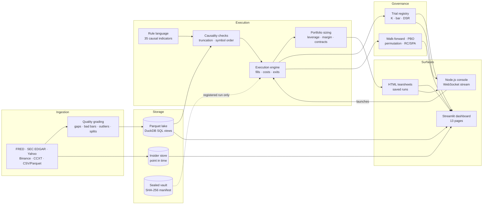
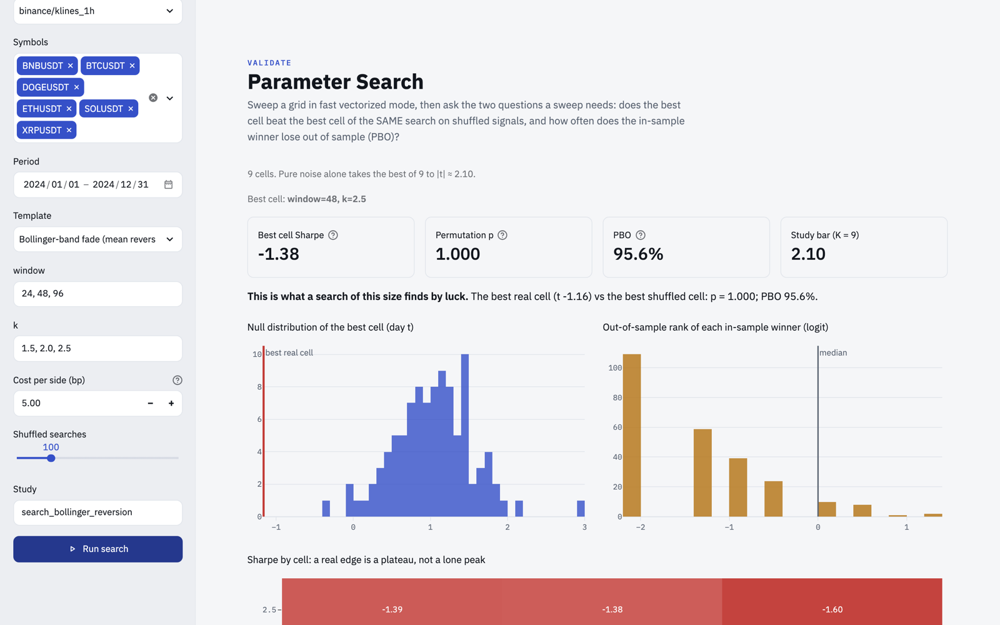
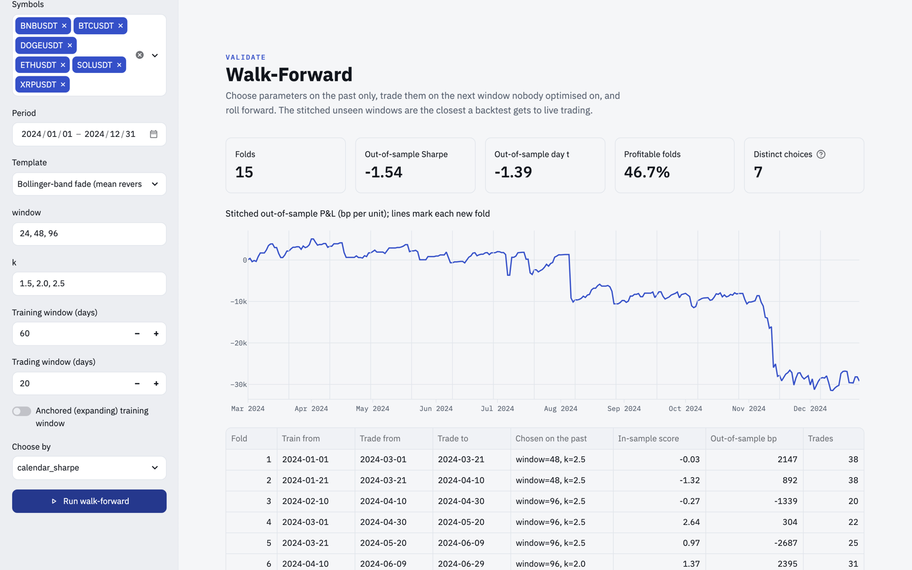
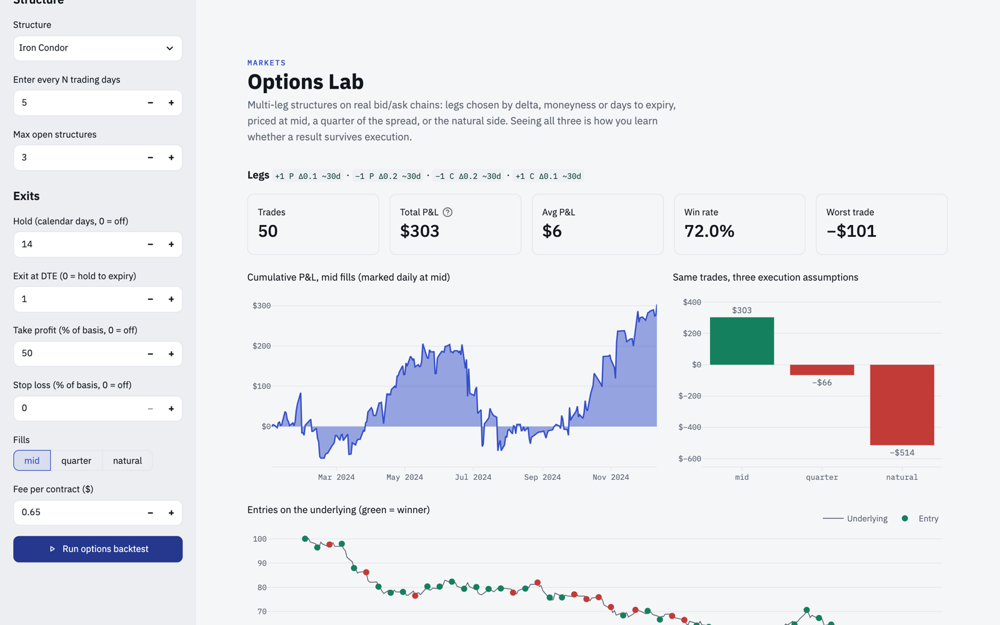
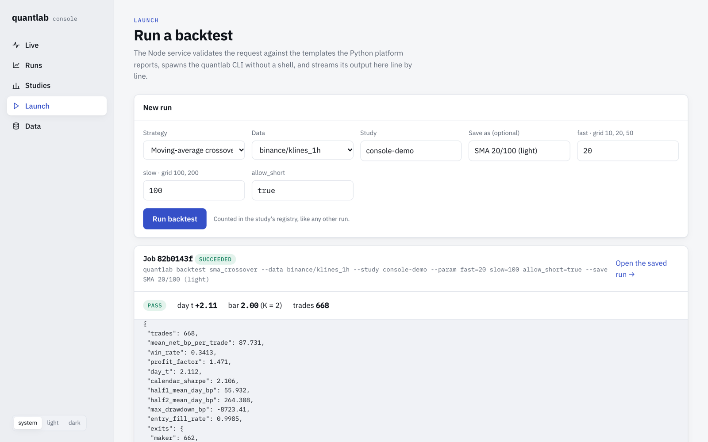

<h1 align="center">quantlab</h1>

<p align="center"><b>Backtests that can't lie to you.</b></p>

<p align="center">
A financial data lake, an automated data-quality pipeline, a deterministic execution engine and a
multiple-testing governance layer,<br/>
surfaced through a 13-page analytics dashboard and a real-time Node.js console. Python · SQL · TypeScript.
</p>

<p align="center">
  <a href="https://github.com/Skippy-8/quantlab/actions/workflows/ci.yml"></a>
  <a href="https://skippy-8.github.io/quantlab/"></a>
  
  
  
  
  
</p>

<p align="center">
  <a href="https://skippy-8.github.io/quantlab/"><b>Documentation</b></a> ·
  <a href="#quickstart">Quickstart</a> ·
  <a href="#architecture">Architecture</a> ·
  <a href="#pre-flight-data-qc">Data &amp; QC</a> ·
  <a href="#whole-search-permutation-null">Validation</a> ·
  <a href="#cli-reference">CLI Reference</a> ·
  <a href="console/">Live Console</a>
</p>


## Why quantlab exists

A research result is only as credible as the weakest step that produced it. Standard pipelines
fail in four places, and each failure inflates the result without leaving a trace. quantlab turns
each one into an enforced invariant: a run that violates it is refused, not reported.

**1. Data integrity and point-in-time isolation.** Every series is graded before analysis for gaps,
duplicate timestamps, impossible bars (high below low, close outside the range, non-positive prices),
one-bar outliers beyond *k* robust standard deviations, and moves that match an unadjusted split
ratio. SEC Form 3/4/5 filings are stored keyed on acceptance time, so a query as of any timestamp
returns only what was public then.

**2. Temporal and cross-sectional causality.** Before any P&L is computed, every strategy is replayed
on truncated histories and on a reversed symbol order. If a single signal differs, `evaluate` raises
`LookaheadError` naming the symbol and timestamp of the first signal that changed.

**3. Microstructure-aware execution.** All strategies share one execution model. Limit orders fill
only when price trades *through* them, within a time-to-live, with a taker fallback. Fees, perpetual
funding, short borrow and futures roll costs are charged. Stops, profit-target ladders, breakeven and
trailing exits support partial fills, and a gap through a stop fills at the open. Options are marked
at mid, quarter and natural. The engine draws no random numbers, so identical inputs produce
identical fills.

**4. Multiple-testing governance and holdout sealing.** A central registry counts every distinct
variant per study, and the significance bar scales with that count as `max(2, √(2 ln K))`. Parameter
searches are tested against a whole-search null, and results are deflated (DSR, PBO by CSCV, White's
Reality Check, Hansen's SPA). The final holdout is sealed by a SHA-256 manifest and opens once per
pre-registered hypothesis.

| | Standard pipeline | quantlab invariant |
|---|---|---|
| **Data** | ingested as delivered | graded per symbol before use; anomalies surfaced for review, never silently dropped |
| **Lookahead** | reviewed by eye, if at all | truncated-history and symbol-reorder replay; any changed signal raises `LookaheadError` |
| **Limit fills** | the bar touched the price | price traded through the limit within its TTL; taker fallback on expiry |
| **Costs** | a flat fee, if any | maker/taker fees, funding, short borrow, roll cost, assumed half-spread |
| **Parameter search** | the best cell is reported | the best cell must beat the best cell of the same search on signal-shifted data |
| **Significance** | t > 2 | `max(2, √(2 ln K))` over K distinct trials, plus a deflated Sharpe over all of them |
| **Holdout** | a final split, often reused | walk-forward, then a hash-sealed vault that opens once per pre-registered spec |
| **Options P&L** | marked at the mid | the same trades at mid, quarter and natural, isolating the cost of the spread |

## Architecture



| Layer | Core modules | Capabilities and invariants |
|---|---|---|
| **Ingestion and columnar lake** | `quantlab/data`, `quantlab/sec` | Hive-partitioned Parquet with one DuckDB SQL view per dataset; atomic, idempotent per-symbol upserts (a re-run load changes nothing); CSV/Parquet import with column detection; per-symbol quality grades. EDGAR client under a shared 8 req/s token bucket with `Retry-After` backoff; filings keyed on `(accession, owner, line)` and queried on acceptance time |
| **Execution and portfolio** | `engine.py`, `portfolio.py`, `futures.py`, `options/`, `events.py` | Through-the-limit fills with TTL and taker fallback; funding, borrow, roll and fee accounting; stop, target-ladder, breakeven, trailing and time exits with partial fills. Sizing by fixed notional, fixed fraction, volatility target or risk per trade, under leverage, position and margin limits. Continuous futures (calendar or volume roll, ratio or difference adjustment); 13 option structures on Black-Scholes or ThetaData chains; market-model event studies with date-clustered t |
| **Declarative rule engine** | `rules.py`, `indicators.py` | Strategies written as expressions, parsed with Python's `ast` against an allow-list of node types, serialised to YAML. 35 indicators, each computed per symbol from past data only |
| **Statistical governance and vault** | `stats/`, `validation.py`, `research/` | Distinct-trial registry with a rising bar; PSR and DSR; Holm and BHY; Harvey-Liu haircut; MinBTL; whole-search permutation nulls; PBO by CSCV; White's Reality Check and Hansen's SPA on a stationary bootstrap; block Monte Carlo; walk-forward; pre-registration by spec hash; the one-shot vault |
| **Analytics UI and reporting** | `dashboard/`, `report/` | 13 Streamlit pages in light and dark themes; standalone HTML tearsheets; saved runs that record a code version and a data fingerprint |
| **Real-time console and operations** | `console/`, `monitor/`, `deploy/` | Fastify and WebSocket service in strict TypeScript; DuckDB embedded in Node; React 19 front end. Job heartbeats with OK / RUNNING / FAILING / STALE states; a health check that exits non-zero for cron and systemd alerting; example systemd timers |

## Verification in practice

Two runs against public data. Both outputs come from the CLI; the quality report's two tables are
condensed into one, with timestamps shortened to dates.

### Pre-flight data QC

Ten years of the 10-year Treasury yield and the unemployment rate, from FRED:

```
$ quantlab fetch fred DGS10 UNRATE --start 2015-01
$ quantlab quality fred/series
symbol  bars       first        last  grade  outlier
 DGS10  2946  2015-01-02  2026-10-13      C        4
UNRATE   140  2015-01-01  2026-09-01      B        1
 DGS10  outlier  2020-03-09   -27.0% in one bar (17 robust sd)
 DGS10  outlier  2020-03-10   +40.7% in one bar (18 robust sd)
UNRATE  outlier  2020-04-01  +236.4% in one bar (34 robust sd)
```

Every flag falls in March or April 2020, at 17 to 34 robust standard deviations. These are genuine
macro shocks, not bad prints. The grader reports them with their dates and magnitudes and removes
nothing, so whether a study includes the COVID-19 regime stays an explicit analyst decision instead
of a side effect of ingestion.

### Whole-search permutation null

A six-cell Donchian breakout grid on six Binance perpetuals, hourly bars, calendar year 2024:

```
$ quantlab search donchian_breakout --data binance/klines_1h --study trend --perm 200
best cell window=100,exit_window=20: day_t 1.33
whole-search permutation p = 0.488 over 200 shuffles (null best median 1.29)
study 'trend': K = 6, bar 2.00
```

The best cell reaches t = 1.33. The null re-runs the entire six-cell search 200 times with each
symbol's signal circularly shifted against its prices. That breaks any real timing while keeping the
signal's autocorrelation. The best null cell matches or beats 1.33 in 48.8% of runs (median 1.29), so
the result is what a search of this size produces by chance. It is recorded in the registry as one of
K = 6 trials against a bar of 2.00.

## Interface and observability

<table>
<tr>
<td width="50%"><br/><sub><b>Live console.</b> A Node watcher tails the registry and heartbeat logs by byte offset, consuming whole lines only, and pushes each new trial, run and job state over a WebSocket.</sub></td>
<td width="50%"><br/><sub><b>Run detail.</b> Daily equity, drawdown, exits and per-symbol P&amp;L, aggregated in SQL by DuckDB embedded in the Node process, reading the run's Parquet files in place.</sub></td>
</tr>
<tr>
<td><br/><sub><b>Parameter Search.</b> Every cell is recorded as a trial; the Sharpe surface is shown with the whole-search null and PBO, because a real edge is a plateau, not a peak.</sub></td>
<td><br/><sub><b>Walk-Forward.</b> Parameters selected on each training window with the vectorized engine, confirmed by the full engine on the next unseen window, and stitched out of sample.</sub></td>
</tr>
<tr>
<td><br/><sub><b>Options Lab.</b> Thirteen structures with legs chosen by delta, moneyness or strike offset; the same trades priced at mid, quarter and natural.</sub></td>
<td><br/><sub><b>Launch.</b> Requests are schema-validated with unknown fields rejected and every argument allow-listed, then the CLI is spawned from an argv array with no shell; output streams line by line and the verdict is parsed.</sub></td>
</tr>
</table>

## Quickstart

**Install** (Python 3.11+):

```bash
git clone https://github.com/Skippy-8/quantlab && cd quantlab
python -m venv .venv && source .venv/bin/activate
pip install -e ".[dashboard,equities,dev]"
quantlab fetch synthetic                  # demo data into the lake, no network needed
```

**Analytics dashboard**, 13 pages:

```bash
streamlit run dashboard/app.py
```

**Live console**, Node.js 22 + React 19:

```bash
cd console && npm install && npm run build
QUANTLAB_HOME=../.quantlab QUANTLAB_LAKE=../data/lake QUANTLAB_CLI=../.venv/bin/quantlab npm start
# → http://127.0.0.1:8787
```

**Python API**:

```python
from quantlab import evaluate
from quantlab.data import Lake
from quantlab.engine import EngineConfig, ExitRules
from quantlab.portfolio import Sizing, simulate
from quantlab.report.tearsheet import Tearsheet
from quantlab.rules import RuleStrategy

df = Lake().read("binance", "klines_1h")
rule = RuleStrategy("RSI dip", long_entry="rsi(14) < 30 and close > sma(200)", long_exit="rsi(14) > 55")
cfg = EngineConfig(exits=ExitRules(unit="atr", stop_loss=2.5,
                                   take_profits=((2, 0.5), (4, 0.5)), breakeven_after=1))

res = evaluate(rule.signal_fn(), df, cfg)       # raises LookaheadError if the rule peeks
pf = simulate(res, Sizing(method="vol_target", target_vol=0.15, max_leverage=2))
Tearsheet.from_results(res, pf, title="RSI dip").save("rsi_dip.html")
```

## CLI reference

| Command | Example | Purpose |
|---|---|---|
| `fetch` | `quantlab fetch fred DGS10 CPIAUCSL UNRATE --start 2010-01` | Ingest from `synthetic`, `binance` (with `--funding`), `yahoo`, `fred` or `ccxt` (`--exchange`) |
| `sec sync` | `quantlab sec sync AAPL MSFT NVDA --since 2022-01-01` | Backfill Forms 3/4/5 into the point-in-time store (needs `SEC_USER_AGENT`) |
| `import` | `quantlab import prices.csv --source broker --dataset daily` | Load any CSV/Parquet; columns detected, times stored in UTC |
| `quality` | `quantlab quality yahoo/daily` | Grade each symbol and list every finding |
| `catalog` | `quantlab catalog` | Datasets, rows, symbols and date ranges in the lake |
| `backtest` | `quantlab backtest donchian_breakout --data yahoo/daily --study etf --tearsheet report.html` | One leak-checked run, recorded in the study and judged against its bar; `--rules file.yaml` for a rule strategy, `--save` to keep it |
| `search` | `quantlab search bollinger_reversion --data yahoo/daily --study etf --perm 200` | Sweep a template's grid, record every cell, run the whole-search permutation null |
| `walkforward` | `quantlab walkforward donchian_breakout --data yahoo/daily --train 750 --test 250` | Rolling out-of-sample selection and evaluation |
| `options` | `quantlab options iron_condor --days 250 --every 5 --hold 14` | Backtest an option structure, priced at mid, quarter and natural |
| `registry` | `quantlab registry --study etf --json` | Trials, distinct K and the current bar per study |
| `prereg` | `quantlab prereg etf prereg/etf-trend.md` | Register a written spec, by hash, before running it |
| `vault` | `quantlab vault seal data/vault` | Seal, verify or audit the out-of-sample vault |
| `monitor` | `quantlab monitor --job fetch_fred=24 --data yahoo/daily=36` | Job and data freshness; exits non-zero on anything not OK |
| `strategies` | `quantlab strategies --json` | The built-in templates, their defaults and grids |

## Deep dives

<details>
<summary><b>The 13-page analytics dashboard</b></summary>

<br/>

| Group | Page | Decision it supports |
|---|---|---|
| | **Overview** | Platform state (datasets, studies, distinct trials, saved runs, completed jobs) and what each step guards against |
| Build | **Strategy Builder** | Author rules, validate them against data for causality, save as YAML |
| | **Backtest Lab** | Configure data, strategy, exits, costs and sizing. The verdict against the study's bar, with equity, drawdown, rolling Sharpe, monthly returns, trade map, robustness and splits. Export a tearsheet or save the run |
| Validate | **Parameter Search** | Whether the best cell beats the best cell of the same search on shifted signals; the probability of backtest overfitting; the Sharpe surface |
| | **Walk-Forward** | Whether parameters chosen on the past hold on the next window |
| | **Robustness** | Monte Carlo drawdown and outcome ranges; Reality Check and SPA across saved runs |
| | **Compare Runs** | Saved runs side by side, with their manifests |
| Markets | **Options Lab** | Structure P&L on synthetic or ThetaData chains, and how much of it the spread consumes |
| | **Event Studies** | Cumulative abnormal returns around uploaded, earnings or insider events; trade them through the engine |
| | **Insider Filings** | Open-market purchases by role, cluster buys, a point-in-time view |
| Data | **Data Manager** | Catalog and coverage, file import, public fetchers, quality grades, continuous futures, SQL console |
| Governance | **Research Registry** | Each trial against the bar it faces as K grows; pre-registration |
| | **Monitoring** | Job heartbeats and data freshness |

Every page is rendered headlessly in CI, and its main action is executed.
</details>

<details>
<summary><b>The declarative rule language and its 35 indicators</b></summary>

<br/>

A strategy can be written by someone who does not write Python, reviewed in a pull request, and
reproduced exactly:

```yaml
name: RSI dip in an uptrend
long_entry:  rsi(14) < 30 and close > sma(200)
long_exit:   rsi(14) > 55
exits: {unit: atr, stop_loss: 2, take_profits: [[2, 0.5], [4, 0.5]], breakeven_after: 1}
```

- **Grammar:** price and volume columns, indicator calls, `crosses_above` / `crosses_below`,
  arithmetic, comparisons, and `and` / `or` / `not`.
- **Safety:** expressions are parsed with Python's `ast`, and only those node types are admitted.
  Attribute access, subscripts, lambdas, imports and unknown names are rejected, so a rule file
  cannot execute arbitrary code.
- **Causality:** every indicator is computed per symbol from past data only, and every rule still
  passes through the engine's truncation and symbol-order replay.

Indicators: `adx` `atr` `bb_lower` `bb_pct` `bb_upper` `cci` `donchian_high` `donchian_low` `ema`
`highest` `hma` `keltner_lower` `keltner_upper` `lag` `lowest` `macd` `macd_hist` `macd_signal` `mfi`
`momentum` `natr` `obv` `realized_vol` `roc` `rsi` `sma` `stoch_d` `stoch_k` `supertrend_dir`
`true_range` `volume_z` `vwap` `williams_r` `wma` `zscore`.
</details>

<details>
<summary><b>Testing, the cross-language contract and CI</b></summary>

<br/>

221 tests: 175 in pytest and 46 in Vitest.

- **Execution:** fill rules (through-the-limit, TTL expiry, taker fallback), exits with partial fills
  and gap-through-stop handling, stop-before-target ordering within a bar, borrow and roll costs;
  sizing methods, leverage and position limits, whole-contract rounding.
- **Statistics:** checked against published values, including DSR, PSR, Holm, BHY and the noise
  bar; the Reality Check rejection rate under a true null across seeds.
- **Integrity:** lookahead and symbol-leak detection on deliberately leaking strategies; vault
  sealing and one-shot runs; idempotent lake upserts; the SEC parser on raw ownership XML.
- **Dashboard:** every Streamlit page rendered headlessly with its main action executed.
- **Console:** byte-offset tailing (partial lines, multi-byte characters split across reads, file
  rotation), the registry and heartbeat state, argument allow-listing against injection attempts,
  the job lifecycle (timeouts, crashes, queueing), and the HTTP and WebSocket API against a fixture
  home built with DuckDB.
- **Cross-language contract:** CI has the Python CLI write a real research home, then requires the
  Node service to match `quantlab registry --json` on every study's runs, K and bar, and to read
  every saved run.

GitHub Actions runs four jobs on every push: Python 3.11 and 3.12 (ruff, pytest, an end-to-end CLI
smoke test), Node (strict `tsc`, Vitest, production build), and the contract. A fifth workflow builds
the documentation with `mkdocs --strict` and publishes it to GitHub Pages.
</details>

## Repository layout

```
quantlab/
  engine.py         execution model, exits, causality checks, summary statistics
  portfolio.py      dollar equity, sizing methods, leverage and margin limits, contract specs
  rules.py          the rule language: allow-listed AST evaluation, YAML round trip
  indicators.py     35 causal indicators
  fast.py           a vectorized engine for large sweeps
  validation.py     walk-forward, PBO, Monte Carlo, Reality Check / SPA
  futures.py        continuous contracts and roll schedules
  options/          Black-Scholes and implied volatility, chains, multi-leg backtests
  events.py         market-model event studies and event-driven strategies
  stats/            DSR, PSR, Holm/BHY, Harvey-Liu, MinBTL, bootstrap, permutation nulls
  research/         trial registry, pre-registration, sealed vault, splits, saved runs
  report/           metrics, Plotly charts, HTML tearsheets
  data/             the lake, importers, quality grading, FRED/Yahoo/Binance/CCXT sources
  sec/              EDGAR client, Form 3/4/5 parser, point-in-time store
  monitor/          heartbeats and health checks
dashboard/          Streamlit application, 13 pages
console/            Node.js + TypeScript service, React front end, Vitest suite
docs/               MkDocs Material documentation site
deploy/             example systemd services and timers
tests/              pytest suite
```

## References

- Bailey & López de Prado (2014), *The Deflated Sharpe Ratio: Correcting for Selection Bias, Backtest Overfitting and Non-Normality*
- Bailey, Borwein, López de Prado & Zhu (2017), *The Probability of Backtest Overfitting*
- Harvey & Liu (2015), *Backtesting*
- White (2000), *A Reality Check for Data Snooping*
- Hansen (2005), *A Test for Superior Predictive Ability*
- Cohen, Malloy & Pomorski (2012), *Decoding Inside Information*

The [methodology page](https://skippy-8.github.io/quantlab/concepts/methodology/) maps each control
to the failure it prevents.

## Scope and license

quantlab contains no proprietary strategies or data. The bundled strategies are textbook templates,
and all data is fetched from public sources or generated. MIT licensed.
