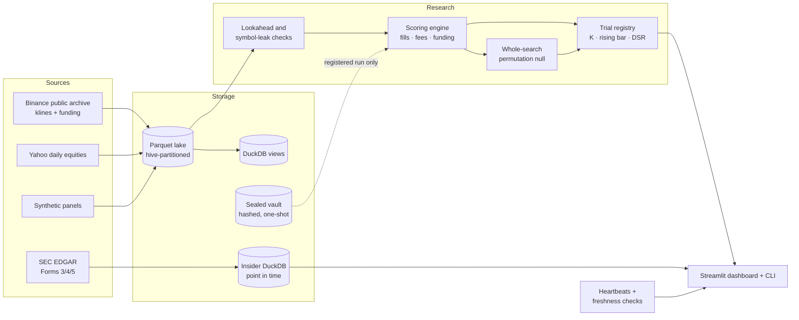

# quantlab

**A research platform for honest backtests.** Most backtests overstate their results for three
reasons: the strategy quietly uses future data, the fills are better than the market would have
given, and nobody counts how many variants were tried before the "winner". quantlab makes each of
those mechanically hard to get wrong:

- **One execution model for every strategy.** Strategies decide *what* to trade; a standardized
  engine decides *how* it fills. That covers maker limit orders that need price to trade through
  them, expiry with a taker fallback, fees and funding.
- **Integrity checks before any P&L.** Every strategy is re-run on truncated data and on reordered
  symbols. One that reads the future, or lets one symbol's rows leak into another's, is rejected
  with the row that proves it.
- **Every trial is counted.** A trial registry records each run by study. The pass bar
  rises with the number of distinct trials (`|t| ≥ max(2, √(2 ln K))`), and the deflated Sharpe
  uses every trial's Sharpe, including the abandoned ones.
- **A sealed out-of-sample vault.** A held-out dataset is hashed and locked. It can be read only
  inside a registered run, and only once per pre-registered hypothesis.
- **Data and monitoring.** A Parquet lake with a DuckDB catalog, public-data fetchers, a
  point-in-time SEC insider-filings pipeline, and heartbeat/freshness checks for scheduled jobs.

It ships with a Streamlit dashboard and a CLI, and contains no proprietary strategies or data: the
included strategies are textbook examples, and all data is fetched from public sources or generated.



## Quick start

```bash
git clone https://github.com/<you>/quantlab && cd quantlab
python -m venv .venv && source .venv/bin/activate
pip install -e ".[dashboard,dev]"

quantlab fetch synthetic                       # demo data, no network
quantlab backtest sma_crossover --study demo --splits
quantlab search bollinger_reversion --study demo --perm 200
quantlab registry --study demo
streamlit run dashboard/app.py
```

Real data, all public:

```bash
quantlab fetch binance BTCUSDT ETHUSDT SOLUSDT --start 2024-01 --end 2024-12 --funding
quantlab backtest xs_momentum --data binance/klines_1h --study momentum
pip install -e ".[equities]" && quantlab fetch yahoo SPY QQQ IWM --start 2015-01-01
SEC_USER_AGENT="Your Name you@example.com" quantlab sec sync AAPL MSFT NVDA --since 2022-01-01
```

## What a result looks like

```
$ quantlab search sma_crossover --study grid --perm 200
best cell fast=50,slow=100: day_t 0.51
whole-search permutation p = 0.950 over 200 shuffles (null best median 1.66)
study 'grid': K = 6, bar 2.00
```

The best of six parameter sets looks mildly positive. The *same six-cell search*, re-run on
signals shifted against prices, does at least as well 95% of the time (its median best cell
reaches t 1.66), so the "best cell" is what any search of that size finds by luck. That is the comparison quantlab is built to make the default.

## Dashboard

| Page | Purpose |
|---|---|
| **Backtest Lab** | Pick data, a strategy and costs. You get the verdict against the study's bar, the equity curve and drawdown, the robustness checks (calendar halves, symbol-clustered bootstrap, mean without the top 5 symbols) and the standard splits |
| **Parameter Search** | A grid of cells, every one recorded, and the null distribution of the best cell on shuffled signals |
| **Research Registry** | Each study's trials against the bar they face as K grows; pre-registration status |
| **Data & Monitoring** | The lake catalog, bars per day (gaps show as dips), a read-only SQL console, and job and data health |
| **Insider Explorer** | Open-market purchases by role, with 10b5-1 plan trades excluded; cluster buys; a point-in-time "what was public on date X" view |

## Writing a strategy

```python
import numpy as np

def make(fast=20, slow=100):
    def fn(df):                       # the whole panel, sorted by symbol then time
        g = df.groupby("symbol")["close"]
        f = g.transform(lambda s: s.rolling(fast).mean())
        s = g.transform(lambda s: s.rolling(slow).mean())
        return df.assign(signal=np.where(f > s, 1, -1))   # position wanted after each close
    return fn

from quantlab import evaluate
res = evaluate(make(10, 50), df)       # raises LookaheadError if fn peeks
print(res.summary["day_t"], res.summary["calendar_sharpe"])
```

Forget the `groupby`, or use `shift(-1)` or a full-sample mean, and `evaluate` refuses to score it.

## Project layout

```
quantlab/
  engine.py            execution model, eligibility, integrity checks, summary statistics
  stats/               deflated Sharpe, PSR, Holm/BHY, Harvey-Liu haircut, MinBTL, bootstrap,
                       clustered t, permutation nulls
  research/            trial registry + pre-registration, sealed vault, standard splits
  data/                Parquet/DuckDB lake, Binance + Yahoo sources, synthetic panels
  sec/                 EDGAR client (rate limited), Form 3/4/5 parser, point-in-time store, sync
  monitor/             heartbeats and health checks (non-zero exit for alerting)
  strategies/          textbook examples (trend, mean reversion, breakout, cross-sectional)
dashboard/             Streamlit app
deploy/                example systemd units for scheduled fetches and health checks
docs/methodology.md    the execution model and the overfitting controls, with references
tests/                 engine fill rules, lookahead detection, statistics against published
                       values, registry, vault, SEC parser, lake, monitoring
```

## Methodology

See [docs/methodology.md](docs/methodology.md). Key references:
Bailey & López de Prado (2014), *The Deflated Sharpe Ratio*; Harvey & Liu (2015),
*Backtesting*; Bailey, Borwein, López de Prado & Zhu (2014), *Pseudo-Mathematics and Financial
Charlatanism*; Cohen, Malloy & Pomorski (2012), *Decoding Inside Information*.

## License

MIT
