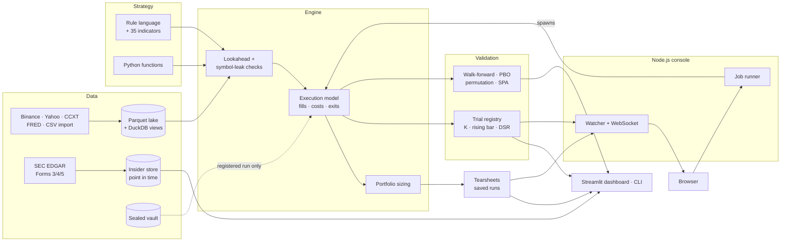

<h1 align="center">quantlab</h1>

<p align="center"><b>Backtests that can't lie to you.</b></p>

<p align="center">
An end-to-end financial data platform and research engine: multi-source ingestion into a DuckDB/SQL
data lake, automated data-quality and lookahead checks, statistical validation that counts every
attempt, stakeholder-ready reports, a 13-page analytics dashboard and a real-time Node.js console.
</p>

<p align="center">
  <a href="https://github.com/Skippy-8/quantlab/actions/workflows/ci.yml"></a>
  <a href="https://skippy-8.github.io/quantlab/"></a>
  
  
  
  
  
</p>

<p align="center">
  <a href="https://skippy-8.github.io/quantlab/"><b>Documentation</b></a> ·
  <a href="https://skippy-8.github.io/quantlab/getting-started/">Five-minute start</a> ·
  <a href="https://skippy-8.github.io/quantlab/concepts/methodology/">Methodology</a> ·
  <a href="console/">Live console</a>
</p>


## The problem

Almost every backtest you have seen is too good, and for the same three reasons:

- **It reads the future.** One centred rolling window, one full-sample mean, one `shift(-1)`, and the
  equity curve goes vertical.
- **It fills at prices nobody would have given it.** The close touched your limit, so it filled.
  Fees, funding, borrow and rolls are a rounding error, apparently.
- **It forgets what it tried.** The winner of 200 parameter sets is presented as if it were the only
  idea anyone ever had.

quantlab is built so that none of these can happen quietly. A strategy that peeks is **refused,
with the row that proves it**. Fills come from **one execution model** that every strategy shares.
And every variant you run is **counted**: the bar a result has to clear rises with the number of
things you tried.

## Highlights

- **Trusted data before any analysis.** Six sources (FRED macro series, rate-limited SEC EDGAR Form
  3/4/5 filings, equities, crypto, any CCXT exchange, and CSV/Parquet files with automatic column
  detection) land in one partitioned Parquet lake, queried in place through DuckDB SQL views.
  `quantlab quality` grades every series for gaps, duplicates, impossible bars, outliers and
  unadjusted splits, and scheduled jobs write heartbeats that alert when a feed goes stale.
- **A strategy that cheats is caught before it is scored.** Every run is replayed on truncated data
  and on reordered symbols. If any past signal changes, the run is rejected.
- **Honest fills.** Limit orders fill only when price trades *through* them, inside a time-to-live,
  with a taker fallback. Fees, funding, short borrow and futures rolls are charged. Stops,
  profit-target ladders, breakeven and trailing exits are modelled with partial fills, and a gap
  through a stop fills at the open.
- **The best cell has to beat luck, not zero.** Parameter searches are re-run on shuffled signals,
  and the best real cell is compared with the best shuffled one. Deflated Sharpe, PBO, White's
  Reality Check, Hansen's SPA, Holm/BHY, walk-forward testing, and a sealed one-shot holdout vault.
- **One platform, every asset class.** Crypto perpetuals with funding, equities, continuous futures,
  multi-leg options priced at mid, quarter and natural, event studies, and a point-in-time SEC
  insider-filings pipeline.
- **Self-service for people who don't write Python.** Rules are written as sentences
  (`rsi(14) < 30 and close > sma(200)`), checked against the data, and saved as YAML that can be
  reviewed and versioned. Any result exports as a standalone HTML report that opens in a browser and
  can be emailed. Every saved run records its code version and a data fingerprint, so it can be
  reproduced exactly later.
- **Live and observable.** A Node.js console streams every trial, run and job heartbeat to the
  browser as it happens. It can launch backtests and stream their output too.

## See it

<table>
<tr>
<td width="50%"><br/><sub><b>Live console (Node.js).</b> Every trial, run and heartbeat on the platform, pushed over a WebSocket.</sub></td>
<td width="50%"><br/><sub><b>Run detail.</b> Equity and drawdown read straight from Parquet by DuckDB inside Node.</sub></td>
</tr>
<tr>
<td><br/><sub><b>Parameter Search.</b> Every cell counted, and the best one tested against the best of the same search on shuffled signals.</sub></td>
<td><br/><sub><b>Walk-Forward.</b> Parameters chosen on the past only, then stitched across windows nobody optimised on.</sub></td>
</tr>
<tr>
<td><br/><sub><b>Options Lab.</b> Thirteen structures, legs chosen by delta, moneyness or offset, priced three ways.</sub></td>
<td><br/><sub><b>Launch from the browser.</b> Validated, spawned without a shell, streamed line by line, verdict parsed.</sub></td>
</tr>
</table>

## How it differs from a typical backtest

| | Typical backtest | quantlab |
|---|---|---|
| Limit-order fills | the bar touched the price | price traded through it, within a time-to-live |
| Lookahead | reviewed by eye, if at all | replayed on truncated data and refused if any past signal changes |
| Parameter search | report the best cell | the best cell must beat the best cell of the same search on shuffled signals |
| Significance bar | t > 2 | `max(2, √(2 ln K))` for K distinct trials, plus a deflated Sharpe over all of them |
| Out-of-sample | a final holdout, often reused | walk-forward, and a sealed vault that opens once per pre-registered spec |
| Options P&L | marked at the mid | the same trades at mid, quarter and natural, to show how much of the edge is the spread |

## Two real checks

**Data quality.** Ten years of the 10-year Treasury yield and the unemployment rate, straight from
FRED:

```
$ quantlab fetch fred DGS10 UNRATE --start 2015-01
$ quantlab quality fred/series
symbol  bars       first        last  grade  outlier
 DGS10  2946  2015-01-02  2026-10-13      C        4
UNRATE   140  2015-01-01  2026-09-01      B        1
 DGS10  outlier  2020-03-09   -27.0% in one bar (17 robust sd)
 DGS10  outlier  2020-03-10   +40.7% in one bar (18 robust sd)
UNRATE  outlier  2020-04-01  +236.4% in one bar (34 robust sd)
```

Every flag is March or April 2020. These are real moves, not bad prints, and that is the point: the
grader surfaces them for a person to judge instead of silently deleting them. Then the analyst
decides whether a study should include the COVID shock.

**Statistical significance.** A Donchian breakout grid on six Binance perpetuals, hourly bars, all of
2024:

```
$ quantlab search donchian_breakout --data binance/klines_1h --study trend --perm 200
best cell window=100,exit_window=20: day_t 1.33
whole-search permutation p = 0.488 over 200 shuffles (null best median 1.29)
study 'trend': K = 6, bar 2.00
```

The best of six cells shows t 1.33, and most tools would stop there. quantlab re-runs the *same
six-cell search* 200 times on shuffled signals, and that does at least as well about half the time.
So t 1.33 is what a search that size finds by luck. This is the check quantlab runs by default.

## Three ways in

**The dashboard**: 13 pages for building, validating and comparing strategies.

```bash
pip install -e ".[dashboard]"
quantlab fetch synthetic          # demo data, no network needed
streamlit run dashboard/app.py
```

**The live console**: Node.js and TypeScript, watching the platform in real time.

```bash
cd console && npm install && npm run build
QUANTLAB_HOME=../.quantlab QUANTLAB_LAKE=../data/lake QUANTLAB_CLI=../.venv/bin/quantlab npm start
```

**Python and the CLI**, for anything scripted:

```python
from quantlab import evaluate
from quantlab.data import Lake
from quantlab.engine import EngineConfig, ExitRules
from quantlab.portfolio import Sizing, simulate
from quantlab.report.tearsheet import Tearsheet
from quantlab.rules import RuleStrategy

df = Lake().read("binance", "klines_1h")
rule = RuleStrategy("RSI dip", long_entry="rsi(14) < 30 and close > sma(200)", long_exit="rsi(14) > 55")
cfg = EngineConfig(exits=ExitRules(unit="atr", stop_loss=2.5,
                                   take_profits=((2, 0.5), (4, 0.5)), breakeven_after=1))

res = evaluate(rule.signal_fn(), df, cfg)       # raises LookaheadError if the rule peeks
pf = simulate(res, Sizing(method="vol_target", target_vol=0.15, max_leverage=2))
Tearsheet.from_results(res, pf, title="RSI dip").save("rsi_dip.html")
```

```bash
# ingest: macro, regulatory, market data and your own files
quantlab fetch fred DGS10 CPIAUCSL UNRATE --start 2010-01          # FRED macro series
SEC_USER_AGENT="Your Name you@example.com" \
  quantlab sec sync AAPL MSFT NVDA --since 2022-01-01              # SEC Form 3/4/5 insider filings
quantlab fetch yahoo SPY QQQ IWM TLT --start 2015-01-01            # daily equities and ETFs ([equities] extra)
quantlab fetch binance BTCUSDT ETHUSDT --start 2024-01 --end 2024-12 --funding
quantlab import prices.csv --source broker --dataset daily         # any CSV/Parquet, columns detected

# check: grade the data before anything reads it, and alert on stale feeds
quantlab quality yahoo/daily
quantlab monitor --job fetch_fred=24 --data yahoo/daily=36          # non-zero exit for cron/systemd alerts

# analyse and report
quantlab backtest donchian_breakout --data yahoo/daily --study etf-trend --tearsheet report.html
quantlab walkforward donchian_breakout --data yahoo/daily --train 750 --test 250
```

## Tech stack

| Layer | Built with |
|---|---|
| **Research core** | Python 3.11+, pandas, NumPy; a vectorized fast mode for large sweeps |
| **Data & SQL** | Parquet lake (PyArrow) with one DuckDB SQL view per dataset and a SQL console; FRED, SEC EDGAR, Yahoo, Binance and CCXT sources; CSV/Parquet import with column detection; automated quality grading; idempotent upserts (re-running a load changes nothing) |
| **Research UI** | Streamlit (13 pages), Plotly, standalone HTML tearsheets |
| **Live console** | Node.js 22, TypeScript (strict), Fastify, WebSockets, DuckDB embedded in Node, React 19 + Vite, hand-drawn SVG charts |
| **Quality** | 220+ tests (pytest and Vitest), ruff, strict `tsc`; every dashboard page rendered headlessly in CI; a cross-language contract test holding Python and Node to the same numbers |
| **Ops** | GitHub Actions (Python matrix, Node, contract, docs), MkDocs Material site on GitHub Pages, job heartbeats with freshness alerts, example systemd units |

## Architecture



## Project layout

```
quantlab/
  engine.py         execution model, exits, integrity checks, summary statistics
  portfolio.py      dollar equity, sizing methods, leverage and margin limits, contract specs
  rules.py          the no-code rule language (safe AST evaluation, YAML round trip)
  indicators.py     35 causal indicators
  fast.py           a vectorized mode for large sweeps
  validation.py     walk-forward, PBO, Monte Carlo, Reality Check / SPA
  futures.py        continuous contracts and roll schedules
  options/          Black-Scholes and IV, chains (synthetic or ThetaData), multi-leg backtests
  events.py         event studies (market-model CARs, date-clustered t) and event strategies
  stats/            deflated Sharpe, PSR, Holm/BHY, Harvey-Liu, MinBTL, bootstrap, permutation nulls
  research/         trial registry, pre-registration, sealed vault, splits, saved runs
  report/           metrics, Plotly charts, HTML tearsheets
  data/             the lake, importers, quality grading, public sources (FRED, Yahoo, Binance, CCXT)
  sec/              EDGAR client (rate limited), Form 3/4/5 parser, point-in-time store
  monitor/          heartbeats and health checks
dashboard/          the Streamlit app (13 pages)
console/            the live console: Node.js + TypeScript server, React front end, Vitest suite
docs/               the documentation site (MkDocs Material)
deploy/             example systemd units for scheduled fetches and health checks
tests/              pytest: fill rules, lookahead detection, statistics against published values,
                    exits, sizing, options pricing, rules, every dashboard page
```

## Methodology

The [methodology page](https://skippy-8.github.io/quantlab/concepts/methodology/) explains each
control and what it protects against. Key references:

- Bailey & López de Prado (2014), *The Deflated Sharpe Ratio*
- Bailey, Borwein, López de Prado & Zhu (2017), *The Probability of Backtest Overfitting*
- Harvey & Liu (2015), *Backtesting*
- White (2000), *A Reality Check for Data Snooping*, and Hansen (2005), *A Test for Superior Predictive Ability*
- Cohen, Malloy & Pomorski (2012), *Decoding Inside Information*

## Scope

quantlab contains no proprietary strategies or data. The included strategies are textbook
examples, and all data is fetched from public sources or generated.

## License

MIT
