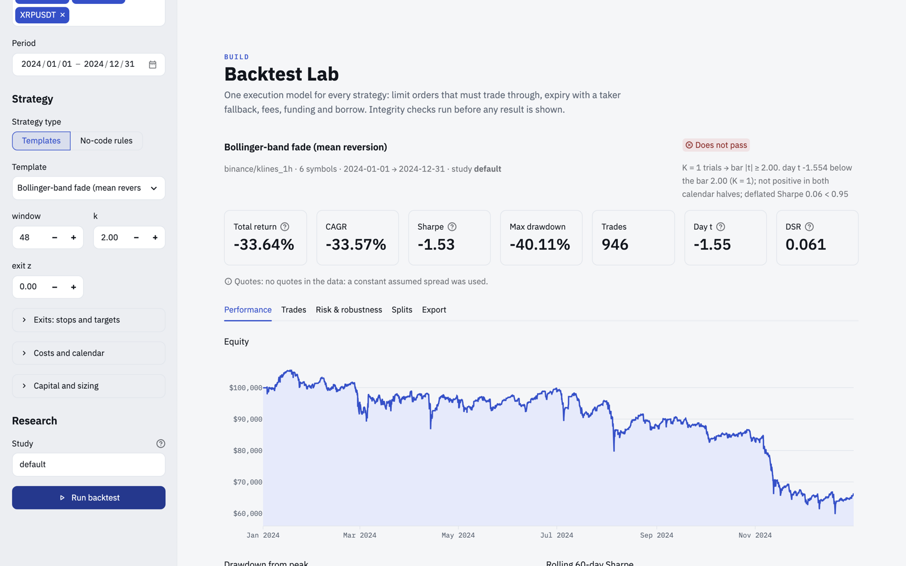

# quantlab

[](https://github.com/Skippy-8/quantlab/actions/workflows/ci.yml)
[](https://skippy-8.github.io/quantlab/)

`quantlab` is a local financial data lake and backtesting toolkit built on Python, DuckDB, and Parquet.
I built it to keep market, macro, and SEC filing datasets in one queryable local store and to run
strategy and event-study research with automated checks for bad data, lookahead bias, and
multiple-testing inflation.

Full documentation is at [skippy-8.github.io/quantlab](https://skippy-8.github.io/quantlab/).



## What's in the repo

* **Parquet data lake and read-only DuckDB SQL (`quantlab/data`, `quantlab/sec`):** Pulls series from
  FRED, Yahoo Finance, SEC EDGAR (Forms 3/4/5, indexed by acceptance timestamp), Binance/CCXT, or
  local CSV/Parquet files into Hive-partitioned Parquet. Each dataset is exposed as a read-only DuckDB
  view for ad-hoc SQL (`quantlab sql` or `Lake().sql()`).
* **Pre-flight data quality checks (`quantlab quality`):** Profiles tables for missing bars,
  duplicates, empty values, invalid OHLC bars (`high < low`, non-positive prices), column
  completeness, unadjusted splits, and multi-sigma return outliers before data is used downstream.
* **Causality and execution engine (`engine.py`, `portfolio.py`, `options/`):** Before scoring a
  strategy, `evaluate()` replays it on truncated history and reordered symbols, raising
  `LookaheadError` if any historical signal changes. Fills require price to trade through limits
  within a TTL, and account for fees, funding, short borrow, futures rolls, and bid/ask spreads
  (including mid, quarter, and natural marks on multi-leg options).
* **Trial tracking and validation (`stats/`, `validation.py`, `research/`):** Logs parameter sweeps
  and backtests to a local registry so significance thresholds scale with the number of trials (K).
  Includes circular-shift permutation tests, walk-forward splits, the Deflated Sharpe Ratio, and a
  hash-sealed holdout directory.
* **Interfaces (`dashboard/`, `console/`, `report/`):** A Streamlit app for interactive analysis,
  standalone HTML tearsheet exports, and a lightweight Node.js/TypeScript web console that tails run
  logs and queries Parquet outputs via DuckDB.

## Example: data QC on FRED series

Pulling 10-year Treasury yields (`DGS10`) and unemployment (`UNRATE`) from FRED and running the
quality grader:

```text
$ quantlab fetch fred DGS10 UNRATE --start 2015-01
$ quantlab quality fred/series
symbol  bars       first        last  grade  outlier
 DGS10  2946  2015-01-02  2026-10-13      C        4
UNRATE   140  2015-01-01  2026-09-01      B        1
 DGS10  outlier  2020-03-09   -27.0% in one bar (17 robust sd)
 DGS10  outlier  2020-03-10   +40.7% in one bar (18 robust sd)
UNRATE  outlier  2020-04-01  +236.4% in one bar (34 robust sd)
```

The grader flags the March/April 2020 COVID-19 moves without dropping rows, leaving regime handling
to the analyst.

## Quickstart

Requires Python 3.11+ (and Node 22+ for the optional web console).

```bash
git clone https://github.com/Skippy-8/quantlab && cd quantlab
python -m venv .venv && source .venv/bin/activate
pip install -e ".[dashboard,equities,dev]"

# Load offline synthetic data and run an example script
quantlab fetch synthetic
python examples/01_macro_sql_and_qc.py
```

### Querying the lake and running a backtest in Python

```python
# first: quantlab fetch yahoo SPY TLT GLD --start 2015-01-01
from quantlab import evaluate
from quantlab.data import Lake
from quantlab.engine import EngineConfig, ExitRules
from quantlab.portfolio import Sizing, simulate
from quantlab.report.tearsheet import Tearsheet
from quantlab.rules import RuleStrategy

lake = Lake()
vol = lake.sql("""
    SELECT symbol, round(100 * stddev(r) * sqrt(252), 1) AS ann_vol_pct
    FROM (
        SELECT symbol, close / lag(close) OVER (PARTITION BY symbol ORDER BY timestamp) - 1 AS r
        FROM yahoo__daily
    )
    GROUP BY symbol ORDER BY ann_vol_pct DESC
""")

rule = RuleStrategy("RSI dip", long_entry="rsi(14) < 30 and close > sma(200)", long_exit="rsi(14) > 55")
cfg = EngineConfig(days_per_year=252, exits=ExitRules(unit="atr", stop_loss=2.5))

res = evaluate(rule.signal_fn(), lake.read("yahoo", "daily"), cfg)
pf = simulate(res, Sizing(method="vol_target", target_vol=0.10, max_leverage=1))
Tearsheet.from_results(res, pf, title="RSI dip on ETFs").save("rsi_dip.html")
```

### Common CLI commands

```bash
quantlab fetch fred DGS10 CPIAUCSL UNRATE --start 2010-01
quantlab fetch yahoo SPY TLT GLD --start 2015-01-01
quantlab import prices.csv --source broker --dataset daily
quantlab sql "SELECT symbol, avg(close) FROM yahoo__daily GROUP BY 1" --format csv
quantlab quality yahoo/daily
quantlab backtest donchian_breakout --data yahoo/daily --study etf --tearsheet report.html
quantlab walkforward donchian_breakout --data yahoo/daily --train 750 --test 250
streamlit run dashboard/app.py
```

`make help` lists the development targets (tests, lint, docs, dashboard, console).

## Project structure

```text
quantlab/
  data/             Parquet lake, read-only DuckDB SQL, importers, data quality profiler, fetchers
  sec/              EDGAR client, Form 3/4/5 XML parser, point-in-time insider store
  engine.py         execution model, exits, lookahead checks, summary stats
  portfolio.py      position sizing, leverage/margin limits, contract specs
  rules.py          AST-parsed expression rules and YAML serialization
  indicators.py     35 technical and volatility indicators
  validation.py     walk-forward, PBO, Monte Carlo, White's Reality Check / SPA
  futures.py        continuous contracts and roll schedules
  options/          Black-Scholes/IV solver, chains, multi-leg option backtests
  events.py         market-model event studies
  stats/            DSR, PSR, multiple-testing corrections, bootstrap, permutation nulls
  research/         trial registry, pre-registration hashes, holdout vault
  report/           metrics, Plotly charts, HTML tearsheets
  monitor/          job heartbeats and data freshness checks
examples/           runnable scripts (macro SQL + QC, SEC event study, governance)
dashboard/          Streamlit UI
console/            Node.js + TypeScript server and React UI
docs/               documentation site source
tests/              pytest suite (193 Python tests; 46 Vitest tests in console/)
```

## License

MIT
