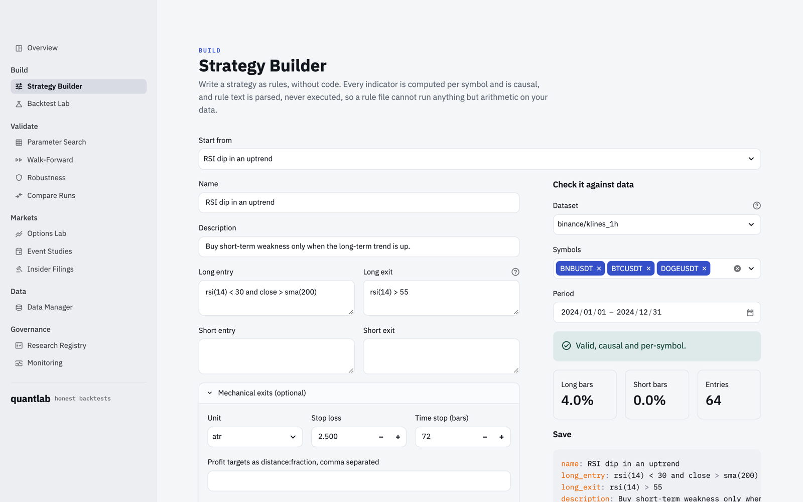
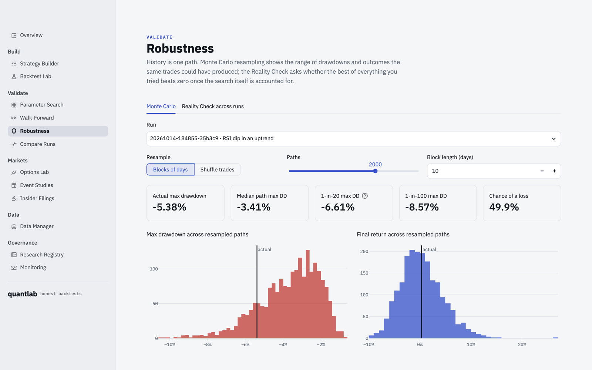
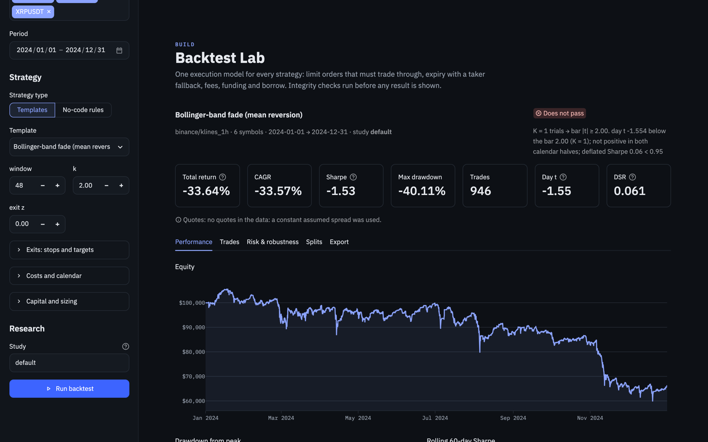
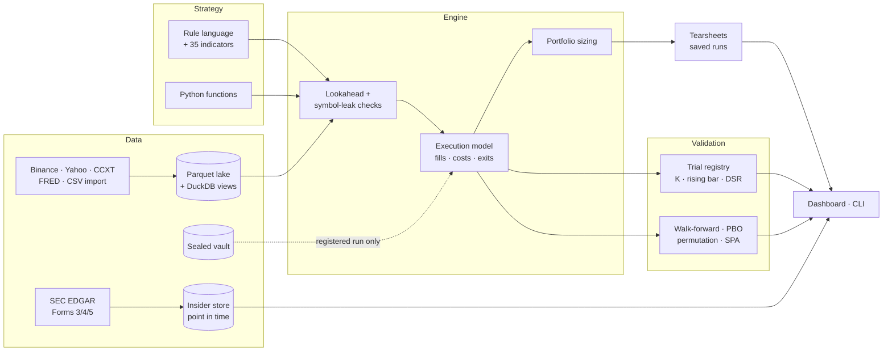

<h1 align="center">quantlab</h1>

<p align="center"><b>A research platform for honest backtests.</b><br/>
Build a strategy, run it through one realistic execution model, and find out whether the result
survives the number of things you tried.</p>

<p align="center">
  <a href="https://github.com/Skippy-8/quantlab/actions/workflows/ci.yml"></a>
  <a href="https://skippy-8.github.io/quantlab/"></a>
  
  
</p>


Most backtests overstate their results for three reasons:

1. **The strategy reads the future.** A centred rolling window, a full-sample mean, or a `shift(-1)`
   is enough, and the equity curve looks wonderful.
2. **The fills are better than the market would have given.** A limit order fills because the
   close touched it, and fees, funding, borrow and rolls are left out.
3. **Nobody counts the attempts.** The best of 200 parameter sets is reported as if it were the
   only one tried.

quantlab makes each of these mechanically hard to get wrong, and then covers the rest of the
workflow around them: data, strategy authoring, validation, reporting and monitoring. It works from
a dashboard, a CLI, or plain Python.

**[Documentation](https://skippy-8.github.io/quantlab/)** ·
[Getting started](https://skippy-8.github.io/quantlab/getting-started/) ·
[Methodology](https://skippy-8.github.io/quantlab/concepts/methodology/)

---

## What is in the box

| | |
|---|---|
| **Execution** | One engine scores every strategy. A limit order fills only when price trades *through* it, unfilled orders expire with a taker fallback, and fees, funding, short borrow and futures rolls are charged. Exits cover stops, profit-target ladders, breakeven and trailing stops with partial fills. A gap through a stop fills at the open, not at the stop |
| **Integrity checks** | Every strategy is re-run on truncated data and on reordered symbols before it is scored. One that reads the future, or leaks one symbol's rows into another's, is rejected, along with the row that proves it |
| **Multiple testing** | A trial registry counts every variant in a study, and the pass bar rises with the count. Includes the deflated Sharpe ratio, Holm and BHY, the Harvey-Liu haircut, whole-search permutation nulls, PBO by CSCV, White's Reality Check and Hansen's SPA |
| **Out-of-sample** | Walk-forward optimisation and a sealed, hashed vault that opens once per pre-registered hypothesis |
| **Portfolio** | Dollar equity under fixed-notional, fixed-fraction, volatility-target or risk-per-trade sizing, with leverage, position and margin limits. Futures trade in whole contracts |
| **Strategies** | 35 causal indicators and a no-code rule language (`rsi(14) < 30 and close > sma(200)`). Rules are parsed safely, never `eval`'d, and stored as YAML. Python covers everything else |
| **Asset classes** | Crypto perpetuals with funding, equities, continuous futures (calendar or volume roll, ratio or difference adjustment), multi-leg options on bid/ask chains, and event studies |
| **Data** | A Parquet lake with a DuckDB catalog. Sources are Binance, Yahoo, any CCXT exchange, FRED and SEC EDGAR. CSV and Parquet import detects columns, and quality reports grade each symbol |
| **Reporting** | Metrics and benchmark statistics, plus a standalone HTML tearsheet. Each saved run records its code version and a data fingerprint |
| **Operations** | Job heartbeats and freshness checks that exit non-zero for alerting, example systemd units, and CI that renders every dashboard page headlessly |

## How it differs from a typical backtest

| | Typical backtest | quantlab |
|---|---|---|
| Limit-order fills | the bar touched the price | price traded through it, within a time-to-live |
| Lookahead | reviewed by eye, if at all | the strategy is re-run on truncated data and refused if any past signal changes |
| Parameter search | report the best cell | the whole search is re-run on shuffled signals, and the best cell must beat the best shuffled cell |
| Significance bar | t > 2 | `max(2, √(2 ln K))` for K distinct trials, plus a deflated Sharpe over every trial |
| Out-of-sample | a final holdout, often reused | walk-forward, and a sealed vault that opens once per pre-registered spec |
| Options P&L | marked at the mid | the same trades at mid, quarter and natural, so you can see how much of the edge is the spread |

## The dashboard

```bash
streamlit run dashboard/app.py
```

Thirteen pages in five groups: **Build** (Strategy Builder, Backtest Lab), **Validate** (Parameter
Search, Walk-Forward, Robustness, Compare Runs), **Markets** (Options Lab, Event Studies, Insider
Filings), **Data** (Data Manager), and **Governance** (Research Registry, Monitoring). It follows the
viewer's light or dark setting.

<table>
<tr>
<td width="50%"><br/><sub><b>Parameter Search.</b> Every cell is recorded as a trial. The best cell is compared against the best cell of the same search on shuffled signals.</sub></td>
<td width="50%"><br/><sub><b>Walk-Forward.</b> Parameters chosen on the past only, stitched across folds nobody optimised on.</sub></td>
</tr>
<tr>
<td><br/><sub><b>Options Lab.</b> Thirteen structures, legs chosen by delta, moneyness or offset, priced at mid, quarter and natural.</sub></td>
<td><br/><sub><b>Strategy Builder.</b> Rules written as sentences, checked for causality against real data, saved as YAML.</sub></td>
</tr>
<tr>
<td><br/><sub><b>Robustness.</b> Monte Carlo drawdown ranges, and Reality Check / SPA across saved runs.</sub></td>
<td><br/><sub><b>Dark theme.</b> The same Backtest Lab.</sub></td>
</tr>
</table>

## Quick start

```bash
git clone https://github.com/Skippy-8/quantlab && cd quantlab
python -m venv .venv && source .venv/bin/activate
pip install -e ".[dashboard,dev]"            # add [equities] for Yahoo data

quantlab fetch synthetic                      # demo data, no network needed
quantlab backtest sma_crossover --study demo --splits
quantlab search bollinger_reversion --study demo --perm 200
quantlab registry --study demo
streamlit run dashboard/app.py
```

Real data, all from public sources:

```bash
quantlab fetch binance BTCUSDT ETHUSDT SOLUSDT --start 2024-01 --end 2024-12 --funding
quantlab quality binance/klines_1h
quantlab backtest donchian_breakout --data binance/klines_1h --study trend \
    --tearsheet report.html --save "Donchian 55/20"
quantlab walkforward donchian_breakout --data binance/klines_1h --train 120 --test 30
quantlab import my_prices.csv --source broker --dataset daily       # your own files
```

## What a result looks like

A Donchian breakout grid on six Binance perpetuals, hourly bars, 2024:

```
$ quantlab search donchian_breakout --data binance/klines_1h --study trend --perm 200
best cell window=100,exit_window=20: day_t 1.33
whole-search permutation p = 0.488 over 200 shuffles (null best median 1.29)
study 'trend': K = 6, bar 2.00
```

The best of six cells looks mildly positive at t 1.33. When the *same six-cell search* is re-run
on shuffled signals, it does at least as well about half the time, so 1.33 is what a search of
that size finds by luck. That comparison is the one quantlab makes by default.

## In Python

```python
from quantlab import evaluate
from quantlab.data import Lake
from quantlab.engine import EngineConfig, ExitRules
from quantlab.portfolio import Sizing, simulate
from quantlab.report.tearsheet import Tearsheet
from quantlab.rules import RuleStrategy

df = Lake().read("binance", "klines_1h")
rule = RuleStrategy("RSI dip", long_entry="rsi(14) < 30 and close > sma(200)", long_exit="rsi(14) > 55")
cfg = EngineConfig(exits=ExitRules(unit="atr", stop_loss=2.5,
                                   take_profits=((2, 0.5), (4, 0.5)), breakeven_after=1))

res = evaluate(rule.signal_fn(), df, cfg)       # raises LookaheadError if the rule peeks
pf = simulate(res, Sizing(method="vol_target", target_vol=0.15, max_leverage=2))
Tearsheet.from_results(res, pf, title="RSI dip").save("rsi_dip.html")
```

A strategy in plain Python is a function from the panel to a `signal` column:

```python
import numpy as np

def sma_cross(df, fast=20, slow=100):
    g = df.groupby("symbol")["close"]
    f = g.transform(lambda s: s.rolling(fast).mean())
    s = g.transform(lambda s: s.rolling(slow).mean())
    return df.assign(signal=np.where(f > s, 1, -1))      # the position wanted after each close
```

Forget the `groupby`, or use `shift(-1)` or a full-sample mean, and `evaluate` refuses to score
it.

## Architecture



## Project layout

```
quantlab/
  engine.py         execution model, exits, integrity checks, summary statistics
  portfolio.py      dollar equity, sizing methods, leverage and margin limits, contract specs
  rules.py          the no-code rule language (safe AST evaluation, YAML round trip)
  indicators.py     35 causal indicators
  fast.py           a vectorized mode for large sweeps
  validation.py     walk-forward, PBO, Monte Carlo, Reality Check / SPA
  futures.py        continuous contracts and roll schedules
  options/          Black-Scholes and IV, chains (synthetic or ThetaData), multi-leg backtests
  events.py         event studies (market-model CARs, date-clustered t) and event strategies
  stats/            deflated Sharpe, PSR, Holm/BHY, Harvey-Liu, MinBTL, bootstrap, permutation nulls
  research/         trial registry, pre-registration, sealed vault, splits, saved runs
  report/           metrics, Plotly charts, HTML tearsheets
  data/             the lake, importers, quality reports, public sources
  sec/              EDGAR client (rate limited), Form 3/4/5 parser, point-in-time store
  monitor/          heartbeats and health checks
dashboard/          the Streamlit app (13 pages)
docs/               the documentation site (MkDocs Material)
deploy/             example systemd units for scheduled fetches and health checks
tests/              172 tests: fill rules, lookahead detection, statistics against published values,
                    exits, sizing, options pricing, rules, every dashboard page
```

## Methodology

The [methodology page](https://skippy-8.github.io/quantlab/concepts/methodology/) explains each
control and what it protects against. Key references:

- Bailey & López de Prado (2014), *The Deflated Sharpe Ratio*
- Bailey, Borwein, López de Prado & Zhu (2017), *The Probability of Backtest Overfitting*
- Harvey & Liu (2015), *Backtesting*
- White (2000), *A Reality Check for Data Snooping*, and Hansen (2005), *A Test for Superior Predictive Ability*
- Cohen, Malloy & Pomorski (2012), *Decoding Inside Information*

## Scope

quantlab contains no proprietary strategies or data. The included strategies are textbook
examples, and all data is fetched from public sources or generated.

## License

MIT
