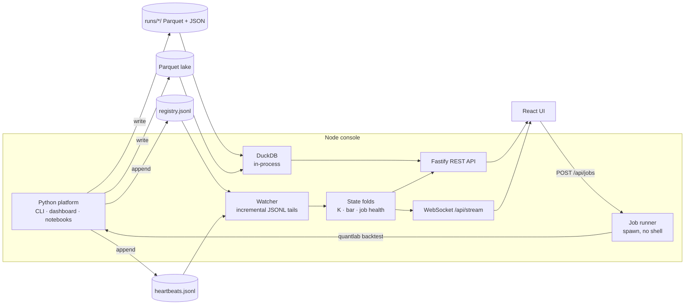

# quantlab console

A real-time operations console for quantlab, written in **TypeScript on Node.js**.

The Python platform does the research; the console watches it. Every trial, saved run and scheduled
job, from the CLI, the Streamlit dashboard, a notebook or the console itself, appears on a live
event tape within a second, pushed over a WebSocket. From the browser you can launch a backtest and
watch its output stream in line by line.

| | |
|---|---|
| **Server** | Node.js 22, TypeScript (strict), Fastify 5, `@fastify/websocket` |
| **Data access** | DuckDB embedded in the Node process (`@duckdb/node-api`) reads the run and lake Parquet files in place |
| **Front end** | React 19 + Vite, no UI kit, hand-drawn SVG charts, light and dark themes |
| **Tests** | Vitest: 45 unit and API tests, plus a cross-language contract test against a home the Python CLI wrote |

## How it works



- **Watching.** A watcher tails `registry.jsonl` and `heartbeats.jsonl` by byte offset and consumes
  whole lines only, so a row caught mid-write (even mid multi-byte character) is read on the next poll
  rather than half-parsed. A file that shrinks is treated as rotated. It polls once a second instead
  of using `fs.watch`, which misses events on network and container filesystems.
- **The same numbers as Python.** The registry fold recomputes each study's distinct-trial count K
  and its noise bar `max(2, √(2 ln K))` exactly as `quantlab.research.registry` does. The contract
  test in CI holds the two implementations to the same values.
- **Launching.** `POST /api/jobs` validates the request against the templates the platform reports
  (`quantlab strategies --json`), rejects unknown body fields, allow-lists every argument, then spawns
  the CLI with an argument array and no shell. Runs are queued behind a concurrency limit, killed on a
  timeout, and write the same heartbeats any scheduled job does, so the console monitors its own work.
  Set `CONSOLE_ALLOW_JOBS=false` for a read-only console.

## Run it

```bash
cd console
npm install
npm run build
QUANTLAB_HOME=../.quantlab QUANTLAB_LAKE=../data/lake QUANTLAB_CLI=../.venv/bin/quantlab npm start
# → http://127.0.0.1:8787
```

Development, with hot reload on both halves: `npm run dev` (API on :8787, Vite on :5173).

| Variable | Default | Meaning |
|---|---|---|
| `QUANTLAB_HOME` | `.quantlab` | registry, heartbeats and saved runs |
| `QUANTLAB_LAKE` | `data/lake` | the Parquet lake |
| `QUANTLAB_CLI` | `quantlab` | how to invoke the Python CLI |
| `CONSOLE_PORT` / `CONSOLE_HOST` | `8787` / `127.0.0.1` | where to listen |
| `CONSOLE_ALLOW_JOBS` | `true` | `false` makes the console read-only |
| `CONSOLE_EXPECT` | — | expected job intervals in hours for stale detection, e.g. `fetch_binance=24,sec_sync=84` |

## API

| Route | Returns |
|---|---|
| `GET /api/overview` | counts of runs, studies, trials, datasets and job states |
| `GET /api/studies`, `/api/studies/:study/trials` | each study's K, bar, best result and every trial |
| `GET /api/runs`, `/api/runs/:id` | saved runs; one run's daily equity, exits and per-symbol P&L via DuckDB |
| `GET /api/monitor` | job health from heartbeats: OK, RUNNING, FAILING, STALE, NEVER_RAN |
| `GET /api/catalog` | the lake's datasets, rows, symbols and date range |
| `GET /api/strategies` | the templates the platform offers |
| `POST /api/jobs`, `GET /api/jobs[/:id]` | launch a backtest; its state, log and parsed verdict |
| `WS /api/stream` | `hello` (snapshot and recent history), then `trial`, `run`, `heartbeat`, `job` and `job-log` events |

## Tests

```bash
npm test                 # unit and API tests against a fixture home built with DuckDB
npm run typecheck
QUANTLAB_HOME=... QUANTLAB_CLI=... npm run test:contract   # against a home the Python CLI wrote
```
