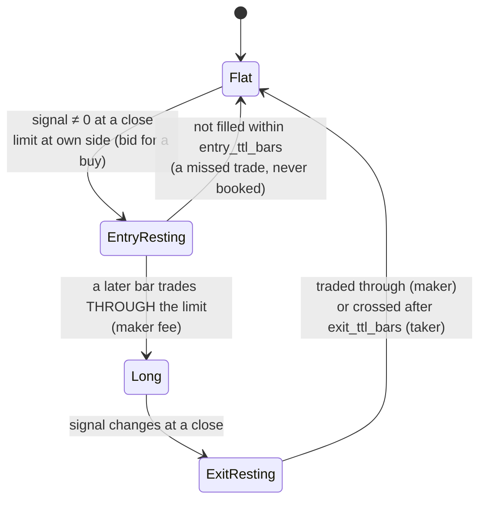

# The execution model

A strategy returns, for every bar, the position it wants **after** that bar's close: −1, 0 or +1.
The engine turns that into orders and fills. It is the same for every strategy, which is what makes
results comparable.

## Signal orders

* Limits are re-pegged to the new touch at every close while they work.
* **Touching** the limit is not a fill. Queue position is unknowable, and counting touches as fills is a
  classic source of phantom profit.
* A position still open at the end of the data is closed at the touch (`eod`).

## Mechanical exits

Configured with `ExitRules`, applied to every position, priced off the actual fill:

| Rule | Behaviour |
|---|---|
| `stop_loss` | Checked **before** targets within a bar (OHLC bars do not say which came first). Fills at the stop, or at the open if the bar gaps through it. Taker fee |
| `take_profits` | `((distance, fraction), ...)`: resting limits that close a fraction of the **original** size when traded through. Maker fee |
| `breakeven_after` | After that many targets fill, the stop moves to the entry price |
| `trailing_stop` | Follows the best price since entry and only tightens. As a percentage it is a fraction of the best price; in ATR units, a fixed ATR distance |
| `time_stop_bars` | Closes whatever remains at that close, crossing the spread |

Distances are a fraction of price (`unit="pct"`) or a multiple of ATR(14) measured on the bar before
entry (`unit="atr"`). After a mechanical exit the strategy cannot re-enter the same way until its
signal changes.

## Costs

$$\text{net}_{bp} = \text{side} \times \left(\frac{p_{exit}}{p_{entry}} - 1\right) 10^4 - \text{fees} + \text{funding} - \text{borrow} - \text{rolls}$$

* **Funding**: each settlement the position is open through, `−side × rate`.
* **Borrow**: shorts pay `short_borrow_bp_per_year`, pro rata to time held.
* **Rolls**: each `roll` bar a futures position is held through costs `roll_cost_bp`.
* **Missing quotes**: `close ∓ assumed_half_spread_bp`, flagged in the summary.

P&L is per unit of notional, so strategies with different turnover compare fairly before any sizing
decision. [Portfolio sizing](../guides/portfolio.md) turns it into dollars.

## Fast mode

For sweeps, `quantlab.fast` computes the same strategy vectorized: the position over bar *t* is the
signal at the close of *t−1*, and every unit of turnover pays `cost_bp` (fees plus half the spread).
It is used to **choose** (sweeps, walk-forward, PBO); the fill engine **confirms**.
