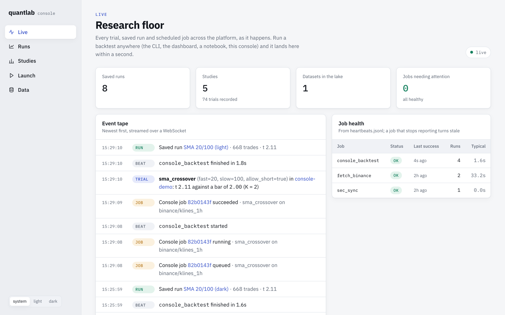
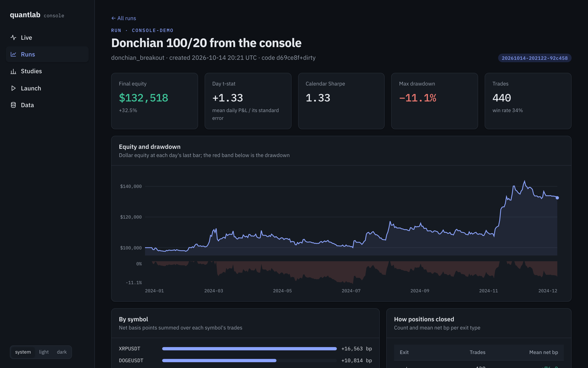

# Live console (Node.js)

`console/` is a real-time operations console written in TypeScript on Node.js. The Python platform
does the research; the console watches it, and can drive it.

{ .shot }

* **A live event tape.** Every trial, saved run and job heartbeat, from the CLI, the dashboard, a
  notebook or the console itself, is pushed to the browser over a WebSocket within a second.
* **Launch from the browser.** Pick a template, data and parameters; the service validates the
  request against what the platform offers, spawns `quantlab backtest` without a shell, and streams
  its output line by line, ending with the parsed verdict against the study's bar.
* **Runs and studies.** Each saved run's daily equity, drawdown, exits and per-symbol P&L, read from
  its Parquet files by DuckDB inside the Node process. Each study's trials plotted against the bar
  they face.
* **Job health.** Heartbeats folded into OK / RUNNING / FAILING / STALE / NEVER_RAN, with the same
  grace factor as `quantlab monitor`.

```bash
cd console && npm install && npm run build
QUANTLAB_HOME=../.quantlab QUANTLAB_LAKE=../data/lake QUANTLAB_CLI=../.venv/bin/quantlab npm start
```

## One set of numbers, two languages

The console recomputes each study's distinct-trial count K and its bar `max(2, √(2 ln K))` from
`registry.jsonl` itself rather than asking Python. To keep the two honest, CI runs a **contract test**:
the Python CLI writes a research home, then the Node test suite reads it and must agree with
`quantlab registry --json` on every study's runs, K and bar, and must read every saved run's Parquet.

{ .shot }

## Safety

* Job launching can be switched off (`CONSOLE_ALLOW_JOBS=false`) for a read-only console.
* Request bodies are schema-validated with unknown fields rejected; every argument is allow-listed
  (strategy against the reported templates, parameter names against that template's defaults, no
  value that could read as a flag) and passed to `spawn` as an array, never through a shell.
* Run ids are pattern-checked before any path is built, so a request cannot walk out of `runs/`.
* Runs are queued behind a concurrency limit and killed on a timeout.

See [`console/README.md`](https://github.com/Skippy-8/quantlab/tree/main/console) for the API and the
configuration variables.
